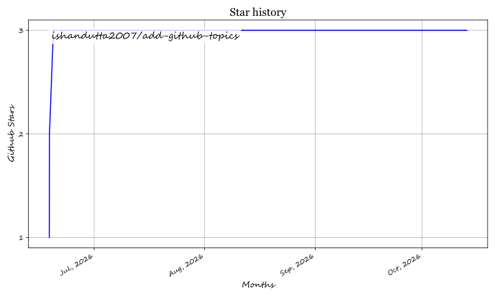

<p align="center">
  <a href="https://github.com/ishandutta2007/add-github-topics">
    
  </a>
</p>

<h1 align="center">🚀 Add GitHub Topics CLI 🏷️</h1>

<p align="center">
  <b>✨ Automate your GitHub repository tagging process with a single command! ✨</b>
</p>

<p align="center">
  <a href="https://github.com/ishandutta2007/Awesome-Awesome-Awesome"></a>
  <a href="https://discord.gg/jc4xtF58Ve"></a>
  <a href="https://pypi.org/project/add-github-topics/"></a>
  <a href="https://pypi.org/project/add-github-topics/"></a>
  <a href="https://github.com/ishandutta2007/add-github-topics/blob/main/LICENSE"></a>
  <a href="https://github.com/ishandutta2007/add-github-topics/stargazers"></a>
  <a href="https://github.com/ishandutta2007"></a>
</p>

---

## 🌟 Overview

`add-github-topics` is a powerful and lightweight **Python CLI tool** designed to help developers and maintainers programmatically manage their GitHub repository topics. Whether you are managing a single project or automating a large-scale migration, this tool simplifies the process of adding descriptive tags to your repositories.

Topics are essential for **SEO on GitHub**, making your projects more discoverable to the community! 🔍✨

---

## ✨ Key Features

- 🔄 **Smart Appending:** Fetches existing topics first to avoid accidental overwrites.
- 🎯 **Zero Config Defaults:** Automatically detects username and repository name from your local git environment.
- 🔒 **Secure Token Handling:** Supports `.env` files and environment variables for managing your GitHub Personal Access Token (PAT).
- 🐙 **GitHub CLI Integration:** Seamlessly inherits credentials from logged-in `gh auth token`.
- 🌍 **Global CLI:** Once installed, run `add-github-topic` from any terminal or directory.
- 💻 **Cross-Platform:** Works smoothly on Windows 🪟, macOS 🍎, and Linux 🐧.

---

## 🚀 Quick Start

### 1. Installation 📦

Install the tool directly from PyPI using `pip`:

```bash
pip install add-github-topics
```

### 2. Configuration ⚙️

Set your GitHub token using any of the following methods (listed in order of priority):

1. 💻 **CLI Argument:**
   ```bash
   add-github-topic python --token ghp_your_token_here
   ```

2. 🌐 **Environment Variable:**
   - 🐧 **Bash / Zsh:**
     ```bash
     export GITHUB_TOKEN=ghp_your_token_here
     ```
   - 🪟 **PowerShell:**
     ```powershell
     $env:GITHUB_TOKEN = "ghp_your_token_here"
     ```

3. 📄 **`.env` File:**
   Create a `.env` file in your repository or home directory:
   ```env
   GITHUB_TOKEN=ghp_your_token_here
   ```
   *(Also supports `GH_TOKEN` and legacy `ADMIN_TOKEN`)*

4. 🐙 **GitHub CLI (`gh`):**
   If you already have [GitHub CLI](https://cli.github.com/) installed and authenticated (`gh auth login`), the CLI automatically falls back to `gh auth token` with zero manual configuration!

### 3. Basic Usage 🛠️

Run the command from within any local git repository:

```bash
add-github-topic python
```

---

## 📚 Documentation & Guides

---

### 👤 For Users 🧑‍💻

#### 1. Installation 📦

Install the latest release directly from PyPI:

```bash
pip install add-github-topics
```

#### 2. Configuration ⚙️

Set your GitHub token using any of the following methods (listed in order of evaluation priority):

1. 💻 **CLI Flag:**
   ```bash
   add-github-topic python --token ghp_your_token_here
   ```
2. 🌐 **Environment Variable:**
   - 🐧 **Linux / macOS (Bash/Zsh):**
     ```bash
     export GITHUB_TOKEN=ghp_your_token_here
     ```
   - 🪟 **Windows (PowerShell):**
     ```powershell
     $env:GITHUB_TOKEN = "ghp_your_token_here"
     ```
3. 📄 **Local `.env` File:**
   Create a `.env` file in your repository or home directory:
   ```env
   GITHUB_TOKEN=ghp_your_token_here
   ```
   *(Supports `GITHUB_TOKEN`, `GH_TOKEN`, and `ADMIN_TOKEN`)*
4. 🐙 **GitHub CLI Integration:**
   If logged into the [GitHub CLI (`gh`)](https://cli.github.com/), `add-github-topic` automatically obtains credentials via `gh auth token`.

#### 3. Common Commands 🛠️

```bash
# 🏷️ Add single or multiple topics
add-github-topic python machine-learning devops

# 📋 List current repository topics
add-github-topic --list

# 🗑️ Remove existing topics
add-github-topic --remove legacy-tag

# 🎯 Target a specific remote repository
add-github-topic python --owner ishandutta2007 --repo awesome-project
```

---

### 💻 For Developers & Contributors 🤝

We warmly welcome contributions to `add-github-topics`! 🎉

#### 1. Local Development Setup 🛠️

1. 📥 **Clone the Repository:**
   ```bash
   git clone https://github.com/ishandutta2007/add-github-topics.git
   cd add-github-topics
   ```

2. 🐍 **Set Up Virtual Environment:**
   ```bash
   python -m venv venv
   # 🐧 On Linux/macOS:
   source venv/bin/activate
   # 🪟 On Windows:
   .\venv\Scripts\activate
   ```

3. 📦 **Install Editable Package:**
   ```bash
   pip install -e .
   ```

#### 2. Code Structure & Guidelines 📐

The codebase is organized into decoupled, modular components under `src/add_github_topics/`:

- 🎮 **[`cli.py`](src/add_github_topics/cli.py):** Main CLI orchestration and execution entrypoint.
- 🧩 **[`parser.py`](src/add_github_topics/parser.py):** Command-line interface definitions, flags, and argument parsing.
- 🌐 **[`api.py`](src/add_github_topics/api.py):** GitHub REST API operations (fetching, updating, adding, removing, and listing topics).
- 🌿 **[`git.py`](src/add_github_topics/git.py):** Local git repository detection and remote URL resolution.
- 🔑 **[`auth.py`](src/add_github_topics/auth.py):** Authentication token resolution (CLI flags, `.env`, env vars, `gh auth token`).
- 🧼 **[`utils.py`](src/add_github_topics/utils.py):** Topic validation and sanitization utilities.

Please follow PEP 8 style guidelines and test changes locally before submitting a PR. ✨

---

### 🚀 For Package Publishers & DevOps 🚢

#### Automated PyPI Publishing 📦

The project uses GitHub Actions with **PyPI Trusted Publishing (OIDC)** for automated releases. 🔒

#### How Version Release & Auto-Publishing Works: 🔄

1. 🏷️ **Version Bump Workflow (Automated on Push):**
   - Whenever you increment the version in `pyproject.toml` (e.g. `version = "0.2.2"`) and push your commit to `main` or `master`:
     ```toml
     [project]
     version = "0.2.2"
     ```
   - The `.github/workflows/publish.yml` workflow triggers automatically.
   - It builds the package source & wheel and attempts to publish to PyPI.
   - **Idempotency (`skip-existing: true`):** If the version has already been published to PyPI, the publish action skips safely without failing.

2. 🔖 **Git Tag Workflow:**
   - Tagged releases (e.g. `v0.2.2`) pushed to GitHub will also trigger auto-publishing:
     ```bash
     git tag v0.2.2
     git push origin v0.2.2
     ```

3. ⚡ **Manual Trigger (`workflow_dispatch`):**
   - You can also trigger a release manually via the **Actions** tab in GitHub.

#### DevOps Initial Setup Checklist (One-time): 📋

- 🔑 Configure PyPI Trusted Publisher for repository `ishandutta2007/add-github-topics`.
- 🛡️ Create environment `pypi` under GitHub Repository Settings -> Environments.

---

## 💖 Support & Community

Thank you for using and exploring **`add-github-topics`**! 🙏

If this project saved you time or made repository tagging effortless, please consider supporting its development:

- ⭐ **Star this repository** on GitHub to show your appreciation and help others discover it!
- 🍴 **Fork and share** it with fellow developers and open-source communities.
- ☕ **Buy me a coffee / Sponsor:** Support ongoing maintenance and new features through the [GitHub Sponsors Dashboard](https://github.com/sponsors/ishandutta2007).

Every bit of support helps keep open-source projects thriving! ✨

---

##  Star History
[](https://star-history.dera.page/#ishandutta2007/add-github-topics&type=date&legend=top-left)

---

<p align="center">
  Made with ❤️ by <a href="https://github.com/ishandutta2007">Ishan Dutta</a>
</p>

## ⭐ Star History

<a href="https://star-history.com/#ishandutta2007/add-github-topics&Timeline" align="center">
  <picture>
    <source media="(prefers-color-scheme: dark)" srcset="assets/ishandutta2007_add-github-topics_growth.svg">
    
  </picture>
</a>
